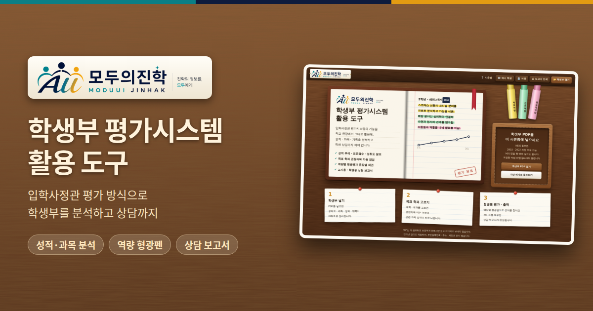

# 모두의진학 · 학생부 평가시스템 활용 도구

입학사정관 평가시스템의 기능을 학교 현장에서 활용해
학생부를 분석하고, 상담 보고서까지 만드는 도구입니다.



## 꼭 지켜 주세요: 실제 학생부는 "내려받은 파일"로

| 쓰는 방식 | 용도 |
|---|---|
| 깃허브 링크로 열기 (https://park-sanggeun-all.github.io/eval-system-for-teachers/) | 소개 · 둘러보기(가상 예시 학생) |
| **Releases에서 내려받은 파일로 열기** | **실제 학생부 분석 (권장)** |

내려받은 파일은 한 번 받으면 바뀌지 않고, 인터넷 없이도 작동합니다.
나중에 저장소 파일이 바뀌어도 이미 받은 파일에는 영향이 없습니다.

### 내려받는 법
1. https://github.com/PARK-SANGGEUN-ALL/eval-system-for-teachers/releases 에 들어갑니다.
2. 최신 버전(예: v1.0)의 `모두의진학_평가시스템활용도구_v1.0.html`을 내려받습니다.
3. 내려받은 파일을 크롬이나 엣지로 엽니다.

## 보안
- PDF는 브라우저 안에서만 읽고, 어떤 서버로도 보내지 않습니다.
- **바깥 연결 차단**(Content-Security-Policy, `connect-src 'none'`)이 들어 있어 화면이 인터넷의 어떤 주소로도 자료를 보낼 수 없습니다.
- 주민등록번호 · 주소 · 사진은 읽지 않고, 이름과 학교명은 가려서 보여 줍니다.
- 작업 저장 파일(.json)과 상담 보고서 PDF에는 학생 정보가 있습니다. 이 저장소나 메신저 · 공용 폴더에 올리지 마세요.
  (`.gitignore`에 .json과 학생부 PDF가 실수로 올라가지 않도록 막아 두었습니다.)

### 받은 파일이 원본과 같은지 확인하기 (선택)
v1.0 배포 파일(`모두의진학_평가시스템활용도구_v1.0.html`)의 SHA-256 값:
```
025279c412f562e36d7713f5aa38f0edfa8df40e849d388555afc1e610cc76f6
```
윈도우 명령 프롬프트에서 `certutil -hashfile 파일이름.html SHA256`로 확인할 수 있습니다.

## 관리자용: 저장소 보안 설정
- 깃허브 계정에 **2단계 인증**을 켭니다.
- 저장소 협업자는 꼭 필요한 사람만 둡니다.
- **Settings → Branches**에서 `main` 브랜치 보호 규칙을 켭니다.
- 새 버전을 낼 때는 반드시 Releases에 버전 번호를 붙여 올립니다.

## GitHub Pages로 소개 페이지 열기
1. 이 폴더의 파일을 저장소에 올립니다(저장소 이름: `eval-system-for-teachers`).
2. **Settings → Pages**에서 Branch를 `main` / `(root)`로 정하고 저장합니다.
3. 1~2분 뒤 https://park-sanggeun-all.github.io/eval-system-for-teachers/ 로 열립니다.

## Releases에 올리는 법
1. 저장소 오른쪽 **Releases → Create a new release**를 누릅니다.
2. **Choose a tag**에 `v1.0`을 입력하고 만듭니다.
3. 제목에 `v1.0`, 설명에 `RELEASE_NOTES.md` 내용을 붙여 넣습니다.
4. 아래 첨부 칸에 함께 받은 `모두의진학_평가시스템활용도구_v1.0.html`을 **고치지 않고 그대로** 끌어다 놓고, `manual.pdf`도 함께 올립니다.
   (배포용 파일은 저장소의 `index.html`과 내용이 같습니다.)
5. **Publish release**를 누릅니다.

## 파일
| 파일 | 설명 |
|---|---|
| `index.html` | 도구 본체(인터넷 없이도 작동하는 단일 파일) |
| `manual.pdf` | 기능 설명서 |
| `og-image.png` · `favicon.png` | 링크 썸네일 · 탭 아이콘 |
| `.gitignore` | 학생 정보 파일이 실수로 올라가지 않게 막음 |

이 도구의 평가와 보고서는 상담용 참고 자료이며, 실제 대학의 평가 결과가 아닙니다.
